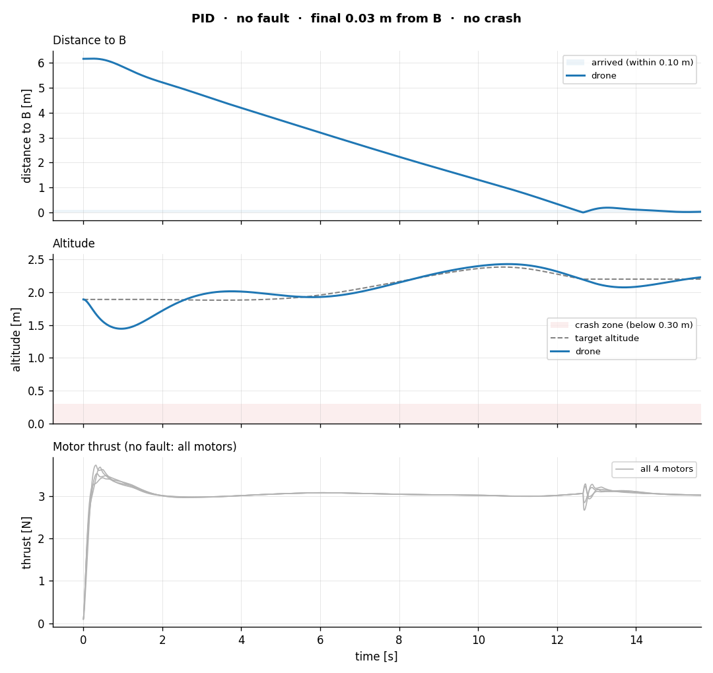
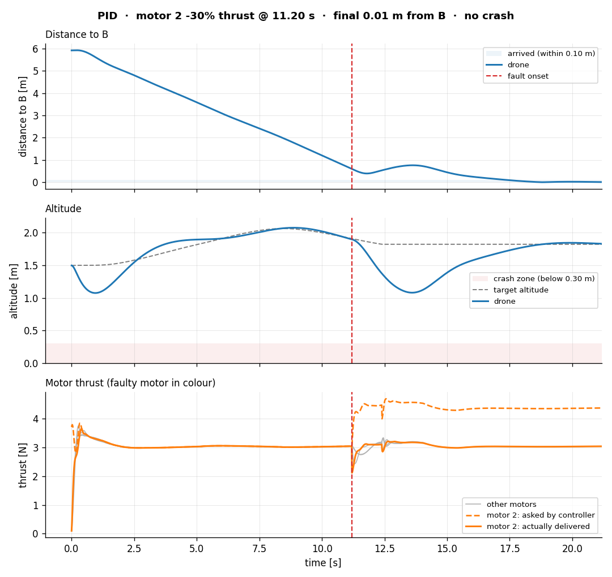
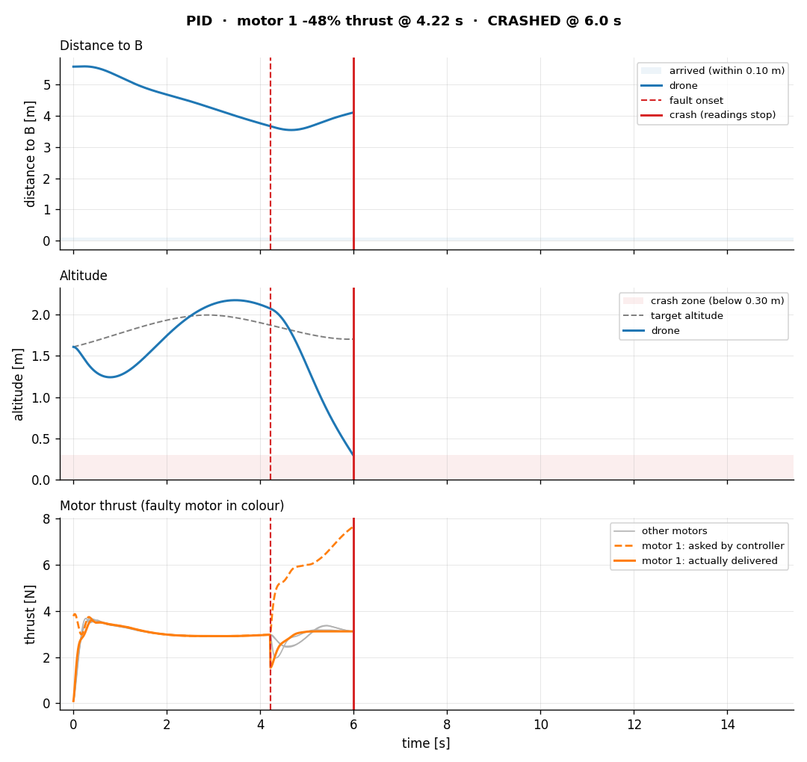

# Drone Degradation Control Adaptation through Proximal Policy Optimization

Thrust-loss study on the ARL Robot 1 quadrotor, in Isaac Lab or MuJoCo. `drone/` flies the simulated quadrotor along
random curved paths from A to B with a PID controller, knocks out part of one motor's thrust mid-flight, logs
everything (true state, clean and noisy IMU, optional front camera), and scores and plots it. Runs are organised in
batches: one folder per run name, one subfolder per seed and per drone.

## The study
Questions:

1. When does a learned correction make a quadrotor more likely to survive than a well-tuned PID controller alone?
2. How much recent flight history does that correction need?
3. Can PPO alone outperform the other fault-control methods?

| Drone | Controller | PPO | Status |
|---|---|---|---|
| **D0** (baseline) | PID | none | **works** |
| D1 | PID | residual PPO (adds a bounded correction to the PID) | slot ready (`drones.py`), no policy yet |
| D2 | PID | residual PPO + memory of recent states | slot ready, no policy yet |
| D3 | none | PPO from scratch (outputs the 4 thrusts) | slot ready, no policy yet |

Every seed defines one flight: a random curved path, a random fault (seed 0 is always the healthy reference) and the
IMU noise. All drones fly the identical flights for the same seeds. `rl/` is reserved for the D1-D3 training code.

## Requirements
- Isaac Lab installed with Isaac Sim (via its `uv` environment), on the **`develop`** branch, on a machine with an
  NVIDIA GPU (Windows or native Linux; WSL does not work for Isaac Sim).
- **Verified on Isaac Lab `develop` commit `49139e1`** (version 3.0.0, Windows 11, RTX 5070 laptop GPU). Newer `develop`
  commits may rename APIs; if something breaks, please report the error together with `git log -1` of your IsaacLab.
- Nothing else to install: numpy, pandas, matplotlib and torch come with Isaac Lab's environment.
- **No Isaac Sim?** Every script also runs in **MuJoCo** on the CPU with `--sim mujoco` (setup and differences in
  [MuJoCo](#mujoco-no-isaac-sim-needed) below). `controllers/`, `faults/`, `motors/`, `paths/`, `sensors/`, `analysis/`
  and `drones.py` never import a simulator.

## Setup (one time)
1. Open `run.sh` (Git Bash / Linux) or `run.ps1` (Windows PowerShell) and set the Isaac Lab path at the top
   (marked `EDIT THIS`). Or skip editing and set an `ISAACLAB_DIR` environment variable instead.
2. That is all. No other path in `drone/` is machine-specific.

## How to run
Use `./run.sh` in Git Bash / Linux, or `.\run.ps1` in PowerShell (`./run.sh` does not work in PowerShell):

```bash
cd drone

# seed 0 (healthy) + seeds 1-5 (random faults)
./run.sh 03_collect_data.py --name myrun --runs 5 --headless

# only the healthy flight, with the viewer
./run.sh 03_collect_data.py --name test --runs 0

# only seeds 3 and 7
./run.sh 03_collect_data.py --name s37 --seeds 3 7 --headless

# also record the front camera (slower)
./run.sh 03_collect_data.py --name cam --runs 2 --camera --headless

# watch one seed's flight; prints progress, saves nothing
./run.sh 02_fly_a_to_b.py --seed 3

# the same batch in MuJoCo (see "MuJoCo" below)
./run.sh 03_collect_data.py --sim mujoco --name myrun_mj --runs 5 --headless
```

All flights of a batch run in one Isaac launch (the drone is reset between flights; a seed flown inside a batch gives
the same result as flown alone). The first launch takes about a minute; then each flight takes ~10-20 s headless, or
about a minute with `--camera`.

Output of `03_collect_data.py --name run1`:
```
data/run1/
  manifest.json            receipt: simulator (Isaac Lab commit or MuJoCo version), GPU, versions, PID gains,
                           settings, command, code hashes
  summary.csv              one row per seed x drone: route length, fault, feasibility, all metrics
                           (rewritten after every flight, so a batch cut short keeps its finished rows)
  seed0/d0/                seed 0 = healthy reference flight
    flight.csv             one row per physics step (100 Hz), columns listed below
    flight.png             distance to B, altitude and motor thrust over time
    flight.json            path, fault, feasibility, metrics
    camera.npz             (with --camera) uint8 frames [N, H, W, 3] at 10 Hz
    camera_preview.png     (with --camera) 8 frames at a glance
  seed1/d0/ ...            seeds 1..N: random faults
```
Only drones that can fly get a folder (today `d0`); `d1`-`d3` appear once a policy is plugged into `drones.py`.
An existing `data/<name>/` is never overwritten: the script stops before Isaac starts unless you add `--overwrite`.

| Step | Command (after `./run.sh`) | What it does | Status |
|---|---|---|---|
| 1 | `01_inspect_env.py --headless` | Prints thrusters, mass, inertia, allocation matrix, thruster params, state at spawn | works |
| 2 | `02_fly_a_to_b.py --seed N` | One seed's flight, prints progress and the moment the fault hits. Saves nothing | works |
| 3 | `03_collect_data.py --name run1 --runs N` | A batch, saved as above | works |
| 4 | D1-D3 training (`rl/`) | Train the PPO drones, then register them in `drones.py` | not started |

Options (`--help` on any script lists them all, plus Isaac Lab's own launcher flags such as `--device`):

| Flag | Meaning | Default |
|---|---|---|
| **03 only** | | |
| `--name run1` | Run name; output goes to `data/<name>/` | required |
| `--runs N` | Faulted seeds 1..N besides the healthy seed 0 | 5 |
| `--seeds 3 7` | Fly exactly these seeds instead (overrides `--runs`; duplicates are dropped) | - |
| `--overwrite` | Replace an existing `data/<name>/` | off |
| **02 only** | | |
| `--seed N` | The seed to fly | 0 |
| **Both** | | |
| `--fault random\|fixed\|none` | Fault for seeds >= 1: `random` = motor, loss and start time drawn from the seed; `fixed` = you choose them with the next three flags (same fault on every seed, paths still differ); `none` = every flight healthy | `random` |
| `--fault_motor 0-3` | Which motor fails (`--fault fixed` only) | 0 |
| `--fault_loss 0.4` | Fraction of thrust lost, 0.0-1.0 (0.4 = loses 40%) (`--fault fixed` only) | 0.25 |
| `--fault_onset 5` | Fault start time in seconds (`--fault fixed` only) | 4.0 |
| `--sim isaac\|mujoco` | Simulator: Isaac Sim, or MuJoCo on the CPU (see [MuJoCo](#mujoco-no-isaac-sim-needed)) | `isaac` |
| `--controller pid\|lee` | Our PID, or Isaac Lab's Lee controller (kept as a regression check; Isaac only) | `pid` |
| `--max_thrust 6` | Per-motor command cap in newtons (same limit as Isaac Lab's drone RL env) | 6 |
| `--speed 0.5` | Speed of the moving target point along the path, m/s | 0.5 |
| `--hold 3` | Seconds to hover at B after arriving | 3 |
| `--max_steps N` | Stop after N physics steps (0.01 s each); `-1` = no limit | -1 |
| `--camera` | Record the front RGB camera at 10 Hz (slows runs ~4x) | off |
| `--camera_res 64\|128` | Camera image size (square) | 64 |
| `--physics isaacsim_physx` | Isaac's physics backend (Isaac only) | `isaacsim_physx` |
| `--headless` | No window (faster) | window opens |

Every flag at once (seed 0 stays healthy; seeds 1-3 each fly their own path with motor 2 losing 40% at 5 s):
```bash
./run.sh 03_collect_data.py --name motor2_40pct --seeds 0 1 2 3 --overwrite \
  --speed 0.7 --hold 4 --max_steps 6000 --controller pid \
  --fault fixed --fault_motor 2 --fault_loss 0.40 --fault_onset 5.0 \
  --max_thrust 6.0 --camera --camera_res 128 --physics isaacsim_physx --headless
```
Notes on `--fault fixed`: seed 0 is still healthy. If `--fault_onset` falls after the drone reaches B, the fault hits
during the hover and the flight is extended so it still runs 10 s after the fault. Only `--max_steps` can cut a flight
short, so leave it off for real runs. Bad values (motor 5, loss 1.5, a negative time) are refused before Isaac starts.

**Paths** (`paths/curve.py`): A, B and 1-3 waypoints inside a 6 x 6 m area at heights 1.0-2.5 m, joined by a smooth
curve (centripetal Catmull-Rom) 3-8 m long, with no turn tighter than 0.5 m. The target point moves along it at
`--speed`, stops at B, and the drone hovers there. The curve never dips below 1 m, so a faulted drone has room to drop.

**Faults** (`faults/thrust_loss.py`): one motor (0-3) loses 10-50% of its thrust, starting while the drone is still
travelling: between 3 s (after the start-up sag settles) and 1 s before it reaches B, never during the hover. A faulted
flight always lasts **at least 10 s after the fault starts**; healthy flights last travel + `--hold`. The fault damages
the motor's output (after Isaac's motor model): a motor that lost 30% can never deliver more than 70% of its maximum,
however hard it is asked. Each flight also records whether the damaged drone could **physically** hover at all with
these motor limits (`feasibility` in the JSON; if not, a crash is not the controller's fault).

<details><summary>Running without the launcher</summary>

The launchers just do this: go to your IsaacLab folder and run
`uv run --extra isaacsim python "<path-to>/drone/03_collect_data.py" --name myrun`.
</details>

## Without a simulator
Run from `drone/`:
```bash
python analysis/plots.py ../sample_run/run1/seed1/d0/flight.csv --out data/replot.png  # redo a plot
python analysis/metrics.py ../sample_run/run1/seed1/d0/flight.csv  # print the metrics
python paths/test_curve.py  # curved-path tests
python controllers/test_pid.py  # PID tests on a toy drone model
python faults/test_faults.py  # fault sampler + feasibility tests
python sensors/test_noise.py  # IMU noise tests
python test_drones.py  # drone registry / observation tests
python motors/test_thruster.py  # motor model (ported from Isaac) tests
```

## MuJoCo (no Isaac Sim needed)
The same scripts, flights and outputs, simulated by MuJoCo on the CPU. Useful without an NVIDIA GPU, and for many fast
runs (a batch of 11 flights takes ~30 s headless).

Setup, once, inside `drone/` (the venv stays there and is ignored by git):
```bash
python -m venv .venv-mujoco
.venv-mujoco/Scripts/python -m pip install -r requirements-mujoco.txt  # Linux/macOS: .venv-mujoco/bin/python
.venv-mujoco/Scripts/python test_sim_mujoco.py  # checks the MuJoCo drone (6 tests)
```
Run: add `--sim mujoco` to any command; the launchers then use `.venv-mujoco` instead of Isaac Lab.
```bash
./run.sh 03_collect_data.py --sim mujoco --name mj1 --runs 10 --headless
./run.sh 02_fly_a_to_b.py --sim mujoco --seed 4  # MuJoCo viewer, real time; green = ideal path, red = flown path
./run.sh 01_inspect_env.py --sim mujoco --headless
```
The drone is a MuJoCo model of the same ARL Robot 1, built in `sim_mujoco.py` from Isaac Lab's numbers: 1.24 kg, the
same inertia, rotors placed so the forces and torques equal Isaac's allocation matrix (tested), Isaac's motor model
ported to `motors/thruster.py` (0.1-10 N, spin-up lag), IMU from MuJoCo's accelerometer and gyro, the same front camera
position, and legs that leave the body 0.25 m above the ground like in Isaac. The PID, paths, faults (on the motor
output), cap, noise, drone slots, metrics and plots are the very same files. `manifest.json` records `"sim": "mujoco"`.

How close it is: on the 11 seeds of the [sample baseline run](#sample-baseline-run), MuJoCo crashes on exactly the
same 4 seeds, final distances to B agree to the millimetre, and the height lost after the fault mostly within
0.01-0.02 m. Differences: the healthy start-up sag is smaller in MuJoCo (max deviation 0.26 vs 0.45 m on seed 0), the
drone looks like a simple box, and each motor's spin-up time is drawn from the seed (Isaac draws it unseeded), so
MuJoCo runs repeat bit-exactly. `--controller lee` is Isaac only.

## Sample baseline run
The repository's `sample_run/` folder (next to `drone/`) holds two D0 batches, 11 flights each, made with this code
and all default settings:

| Folder | Simulator | Command (from `drone/`) |
|---|---|---|
| `run1/` | Isaac Sim | `./run.sh 03_collect_data.py --name run1 --runs 10 --headless` |
| `run1_mujoco/` | MuJoCo | `./run.sh 03_collect_data.py --sim mujoco --name run1_mujoco --runs 10 --headless` |

The scripts write to `drone/data/<name>/`; these two batches were moved to `sample_run/` so that `drone/` ships
without data.

### How to read it
1. **`summary.csv`** first: one row per seed with its route length, its fault (`fault_motor` -1 = none),
   `fault_feasible` and every [metric](#metrics-analysismetricspy-tolerances-are-constants-at-the-top). The table
   below is this file in short.
2. **`seed<k>/d0/flight.png`**: what happened in that flight, over time (explained under the figures below).
3. **`seed<k>/d0/flight.json`**: the path's waypoints, the fault, the feasibility check (the thrust each motor needs
   to hover vs. the most the damaged motor can still give) and the metrics.
4. **`seed<k>/d0/flight.csv`**: the full log, one row per physics step, for your own analysis.
5. **`manifest.json`**: how the batch was made (simulator, versions, GPU, PID gains, settings, the command and the code
   hashes; see [below](#can-this-sample-still-be-reproduced)).

Seed 0 is the healthy reference; every other seed loses part of one motor's thrust. **Survivable** means the damaged
drone could still hover level with its motor limits (`fault_feasible`), so a crash on a survivable fault is the
controller's failure, not physics.

| Seed | Route | Fault | Survivable | Isaac (`run1`) | MuJoCo (`run1_mujoco`) |
|---|---|---|---|---|---|
| 0 | 6.3 m | none | - | reaches B, 0.033 m off | reaches B, 0.030 m off |
| 1 | 6.2 m | motor 1 loses 48% at 4.2 s | yes | **crashes** at 5.99 s | **crashes** at 5.95 s |
| 2 | 4.9 m | motor 3 loses 22% at 7.7 s | yes | recovers in 4.2 s, 0.017 m off | recovers in 4.2 s, 0.018 m off |
| 3 | 7.6 m | motor 3 loses 19% at 12.0 s | yes | recovers in 4.2 s, 0.018 m off | recovers in 4.2 s, 0.018 m off |
| 4 | 6.2 m | motor 2 loses 30% at 11.2 s | yes | recovers in 6.8 s (drops 0.74 m), 0.009 m off | recovers in 6.8 s (drops 0.75 m), 0.009 m off |
| 5 | 3.7 m | motor 2 loses 42% at 4.7 s | yes | **crashes** at 6.22 s | **crashes** at 6.27 s |
| 6 | 7.2 m | motor 1 loses 24% at 6.8 s | yes | recovers in 4.6 s, 0.058 m off | recovers in 4.6 s, 0.057 m off |
| 7 | 4.7 m | motor 3 loses 46% at 7.2 s | yes | **crashes** at 8.29 s | **crashes** at 8.32 s |
| 8 | 6.3 m | motor 2 loses 49% at 5.7 s | **no** | **crashes** at 7.63 s | **crashes** at 7.59 s |
| 9 | 5.3 m | motor 1 loses 21% at 6.9 s | yes | recovers in 4.2 s, 0.011 m off | recovers in 4.2 s, 0.011 m off |
| 10 | 5.2 m | motor 3 loses 18% at 8.3 s | yes | recovers in 4.2 s, 0.014 m off | recovers in 4.2 s, 0.014 m off |

"Recovers in" is the time from the fault until the height is back near the target; "off" is the final distance to B.
The PID recovers from every loss up to 30% and crashes at every loss from 42% up (seeds 1, 5, 7, 8). Three of those
four faults were survivable: that gap is what D1-D3 try to close. Both simulators agree on every seed.

## How to read an output figure

- **Title:** controller, fault, and the outcome in one line.
- **Distance to B:** did the drone get there, and when? The light band is "arrived" (within 0.10 m).
- **Altitude** vs the target altitude (gray dashed; it changes along a curved path). The shaded band is the crash zone.
- **Motor thrust:** the faulty motor in orange, *asked by the controller* (dashed) vs *actually delivered* (solid); the
  other motors in gray. The gap between the orange lines is the fault; the climbing dashed line is the controller
  fighting it.
- Red dashed vertical line = the fault starts. Red solid vertical line = crash; every line stops there.

### Examples

**A healthy flight** (seed 0, `run1/seed0/d0/flight.png`): the dip in the first second is the start-up sag; the
drone then follows the target altitude along the curve and settles 0.03 m from B. All four motors stay near the
hover thrust (~3 N).



**A recovery** (seed 4, `run1/seed4/d0/flight.png`): motor 2 loses 30% at 11.2 s, just before B. The controller
asks it for about 4.4 N (orange dashed) and the damaged motor delivers about 3 N (orange solid), just enough to hover,
so the gap between the orange lines stays open. The drone sinks 0.74 m below the target, climbs back within 6.8 s and
settles 0.009 m from B.



**A crash** (seed 1, `run1/seed1/d0/flight.png`): motor 1 loses 48% at 4.2 s. The controller asks it for more and
more (orange dashed, the command before the 6 N cap), but the damaged motor can deliver only ~3.1 N (orange solid).
The drone sinks into the crash zone and the lines stop at 5.99 s. Hovering needs 3.04 N per motor, so this fault was
just survivable, yet the PID fails it.



### Can this sample still be reproduced?
Only with the exact code that made it. `manifest.json` stores a short SHA-256 hash of every `.py` file in `drone/`.
Any edit breaks the match, even a comment or a line-ending change, and changing a constant (PID gains, motor cap,
fault ranges, path limits, IMU noise) changes the flights themselves. To check whether your `drone/` is still that
code, run this from `drone/` (it prints `same code` or the files that differ):
```bash
python -c "import hashlib,json,pathlib; m=json.load(open('../sample_run/run1/manifest.json'))['code_sha256']; print([f for f,h in m.items() if not pathlib.Path(f).exists() or hashlib.sha256(pathlib.Path(f).read_bytes()).hexdigest()[:12]!=h] or 'same code')"
```
Even with matching code, Isaac numbers can differ in the last digits (GPU physics is not bit-exact); MuJoCo repeats
exactly.

## About the PID baseline: FAQ

1. **Why our own PID and not Isaac Lab's built-in Lee controller?**
Lee has **no integral term**, so under a constant fault it settles offset from B or too low, which would make a weak
baseline and overstate any PPO gain. It also reads Isaac's robot data directly, while our PID is plain PyTorch math
that runs in MuJoCo and in batched RL training too.

2. **What does the PID control, and how?**
It is a cascade: position error -> desired tilt + thrust -> body torques -> 4 motor thrusts. It has integral terms on
height and on attitude (tilt and heading), and it stops integrating while a motor is at its limit (anti-windup). The
gains are constants at the top of `controllers/pid.py` (`PIDGains`).

3. **Why an integral term on attitude?**
Without it, a weak motor leaves the drone settled level but 0.2-0.4 m away from B: the controller needs a leftover
error to keep pushing the weak motor harder. Real flight controllers (e.g. PX4) use attitude integrators for the same
reason.

4. **How much thrust loss can it survive?**
With the 6 N cap, a level hover is physically possible up to about 49% loss on one motor (each flight checks this as
`fault_feasible`). The PID itself recovers from every loss up to 30% and crashes from 42% up; more seeds would pin
down its threshold in between.

## Files
- `run.sh` / `run.ps1`: launchers; Isaac Lab path at the top, `.venv-mujoco` with `--sim mujoco`.
- `common.py`: flight options, CSV columns, faults per seed, the run receipt, and the choice of simulator (`--sim`).
- `sim_isaac.py`: the only file that talks to Isaac Sim (world, drone, IMU, camera, fault hook, flight loop).
- `sim_mujoco.py`: the same for MuJoCo, including the ARL Robot 1 model; `test_sim_mujoco.py` checks it.
- `motors/thruster.py`: Isaac Lab's motor model (spin-up/down lag, 0.1-10 N), for simulators that lack one.
- `controllers/pid.py`: the cascaded PID, pure PyTorch, batched, with anti-windup.
- `faults/thrust_loss.py`: `FaultSpec`, seeded `sample_fault`, `run_duration`, `apply`, `hover_feasibility`.
- `paths/curve.py`: `sample_path(seed)` and the `Path` curve (constant-speed setpoint along it).
- `sensors/noise.py`: seeded IMU noise + bias (`ImuNoise`).
- `drones.py`: the drone registry (d0-d3), the policy slot and `make_observation` (what a policy sees; **never the
  fault**).
- `analysis/`: `metrics.py`, `plots.py`, `route.py` (progress along / deviation from the route).
- `data/`: run outputs (not tracked by git). `rl/`: reserved for the D1-D3 training code.
- CSV columns: `step, t, pos_xyz, quat_xyzw, lin_vel_xyz, ang_vel_xyz, setpoint_xyz` (the route),
  `thrust_cmd_0..3` (asked, before the cap), `thrust_applied_0..3` (delivered), `fault_active, fault_motor, fault_loss`,
  `imu_lin_acc_xyz, imu_ang_vel_xyz` (clean; proper acceleration, so +9.81 m/s^2 on z at hover),
  `imu_lin_acc_noisy_xyz, imu_ang_vel_noisy_xyz`, `camera_frame` (index into `camera.npz`, or -1).

## Metrics (`analysis/metrics.py`, tolerances are constants at the top)
- `final_dist_to_B`: where the drone ended up; **blank (NaN) for a crashed flight**, since a crash is a fail
- `path_length`, `max_deviation` / `mean_deviation` (from the route), `max_sideways_drift` (horizontal only)
- `time_to_arrive`: first time within 0.10 m of B (NaN if never)
- `smoothness`: mean step-to-step change of the commanded thrusts (lower = smoother)
- `fault_onset_t`, `max_alt_loss_after_fault` (deepest drop below the target altitude after the fault)
- `recovery_time`: from onset until the height is back within 0.05 m of the target for 0.5 s (NaN if never)
- `crashed` / `crash_t`: below 0.30 m after the first 0.5 s, or tilted more than 60 deg. Touching the ground counts.

## Things worth knowing
- **Thrust chain:** controller -> 4 thrusts -> (D1/D2: + bounded PPO correction; D3: PPO thrusts instead) -> cap at
  `--max_thrust` -> motor model -> fault damages the faulty motor's output -> physics.
- **Ground height:** the logged height sits 0.25 m above the ground when the drone rests on it, so a height that
  flattens at 0.25 m means the drone is on the ground; the crash rule uses 0.30 m.
- Isaac prints many "Failed to find rigid body ... /Looks/..." warnings at shutdown and a few "[Error]" lines at
  startup; both are harmless.

## Contributions and AI use

See [AI_USE.md](AI_USE.md) for details of the AI tools, prompts and testing used in this project.
